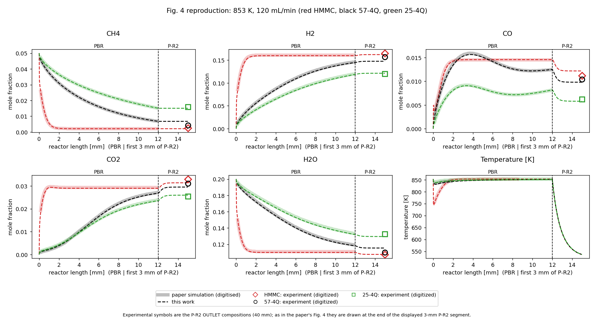
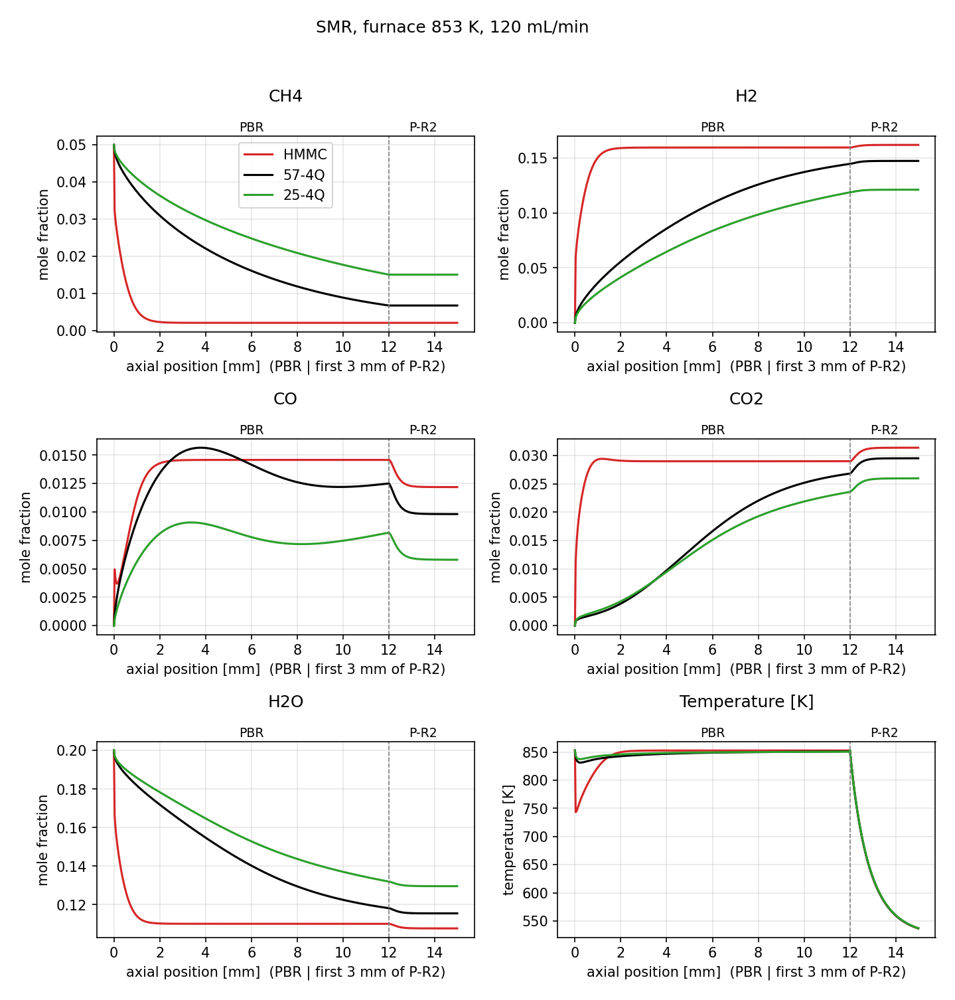
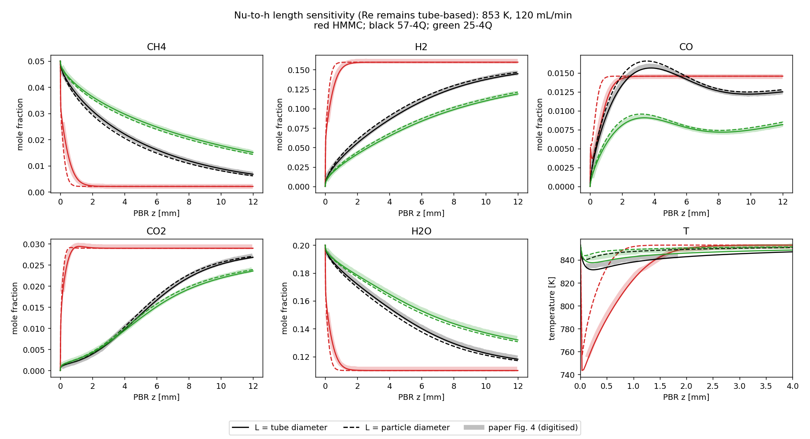
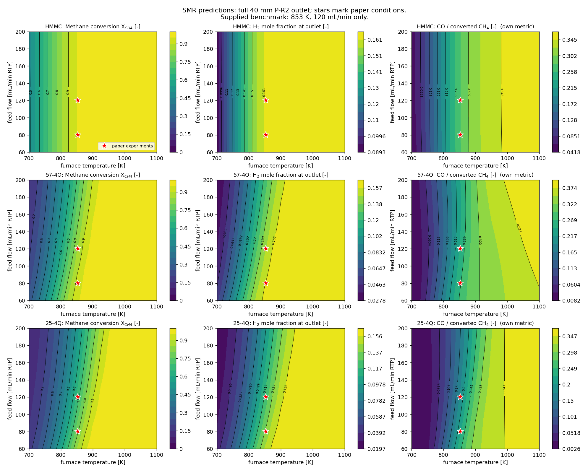
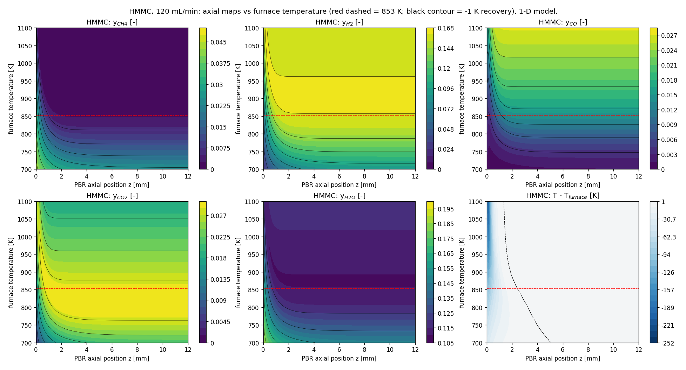

# SMR laboratory-reactor modelling — Costamagna et al. (2020)

Python reproduction of the **SMR portion** of [Costamagna et al., Energies 13, 2624](https://doi.org/10.3390/en13102624).
The 1-D, steady, non-isothermal model follows a 12 mm catalytic PBR, 50 mm glass
P-R1, and 40 mm steel P-R2. Tube ID is 6 mm; catalyst mass is 88.2 mg.
The Figure 4 case uses 853 K, 120 mL/min at RTP (273.15 K, 101.325 kPa),
5% CH4 / 20% H2O / 75% He, and a 523 K P-R2 wall.

**Model selection:** `v3_reproduction` remains the primary/default configuration
because it best reproduces the published species profiles across all three
catalysts. This is a reproduction decision, not proof of physical superiority.
Kinetic factors, equilibrium interpretation, balances and transport physics
remain as evaluated in Phase 2.

## Three distinct comparisons

| Purpose | Reference and location | Evidence and limits |
|---|---|---|
| Reproduction of published numerical profiles | Digitized Figure 4 PBR simulation curves | Curve RMSE; reference points cover visible portions only. No digitized P-R2 curves are supplied. |
| Validation against measured outlet compositions | Figure-read experimental symbols at the **full 40 mm P-R2 outlet** | MAE/RMSE/MAPE for CH4, H2, CO, CO2, H2O. Digitization error is not physical measurement uncertainty. |
| Transport sensitivity | Four explicit PBR transport interpretations | Same geometry, kinetics, properties and Figure 4 conditions. Lower fitting error does not establish physical correctness. |

The **3 mm P-R2 segment is for display**. It is not the experimental sampling
location. Figure-style horizontal axes omit the simulated 50 mm P-R1 unless
`--with-pr1` is selected. The nominal 3 mm summary value retains V3's original
next-grid-point sampling (about 3.0015 mm); this reporting convention is preserved
for numerical regression, not an exact interpolated sample.

The paper also describes experiments at 80 mL/min, but the supplied validation
workflow/data cover **853 K and 120 mL/min only**. Operating sweeps are predictions.
Position-versus-furnace-temperature maps are not radial–axial CFD contours.

## Important current figures

These Phase 4 figures use unchanged default predictions with corrected annotations.

### Published-profile reproduction and experimental outlet comparison



Thick curves show available digitized published PBR simulations; dashed curves
show this model. Experimental markers represent the full outlet, positioned at
the end of the displayed segment. P-R2 curves themselves are not validated here.

### Default species and temperature profiles



### Historical Nu-to-h sensitivity, reproduced with clear labels



This two-case script changes only the Nu-to-h conversion length. For the complete
four-configuration comparison, see [Phase 2](docs/phase2/transport_comparison_report.md).
Original figures remain in [preserved V3 results](results/); their old validation
wording is superseded by this README.

### Operating predictions and refined axial parametric maps





The maps are predictions of a one-dimensional model. Phase 4 increased only the
axial-map source sampling from 400 to 3200 points after independent Radau checks
detected interpolation errors. Operating-window values and reference simulation
arrays remain exactly unchanged. All three catalyst maps and all ten final
figures are listed in the [Phase 4 report](docs/phase4/verification_report.md).

## Installation and execution

Verified environment: Python 3.11.1, NumPy 2.2.6, SciPy 1.15.3,
Matplotlib 3.10.3. `requirements.txt` pins the Phase 1 application environment.
Other Python/platform combinations have not been independently verified.

```sh
python3 -m venv .venv
.venv/bin/python -m pip install -r requirements.txt
.venv/bin/python -m pip check
.venv/bin/python hyd.py
.venv/bin/python hyd.py --validate
.venv/bin/python validation.py
.venv/bin/python compare_h_length.py
.venv/bin/python hyd_contours.py --workers 2
.venv/bin/python run_all.py --workers 2
```

Without `--out`, each command creates a unique timestamped directory under
`runs/`. With `--out NEW_DIRECTORY`, relative paths resolve against the caller's
working directory. Existing nonempty output directories, the repository root,
`results/`, and Phase 1/2 evidence trees are refused. This intentionally replaces
the old overwrite-prone defaults (`.` / `results`). Original commands remain
available, but explicit reused destinations must be changed to fresh directories.

`run_all.py` uses one new parent directory with `model/`, `fixed_reference/`,
`h_length_sensitivity/`, and `contours/` stages. It runs the HMMC-only historical
seed study. Phase 4 executed the entire workflow, including contours, successfully;
the separate numerical verification tool tested seeds for all three catalysts.

`hyd.py --validate` accepts only the fixed benchmark physics/settings: 853 K,
120 mL/min, all catalysts, and `v3_reproduction`. Incompatible requests fail before
writing. Display-only `--pr2-mm` / `--with-pr1` options do not change the benchmark;
its independently generated outputs are isolated in `fixed_reference/`.
Use `validation.py` explicitly when running that reference alongside a custom case.

```sh
.venv/bin/python hyd.py --T 900 --flow 80 --out runs/custom-900K-80
.venv/bin/python validation.py --out runs/reference-853K-120
.venv/bin/python hyd.py --transport-config printed_equations --out runs/printed-example
.venv/bin/python tools/compare_transport.py --out runs/transport-comparison-new
.venv/bin/python -m unittest discover -s tests -v
```

The comparison runner refuses reused destinations and recognizes Phase 3 label
and metric-name migrations when checking V3 numerical regression. Historical
Phase 1 scripts require their recorded source revision; consult their report
before replaying them against a developed checkout.

## Transport definitions and limitations

| Configuration | Re length | Nu-to-h length | Pr conductivity |
|---|---|---|---|
| `v3_reproduction` (default) | tube | tube | gas |
| `v3_h_particle_only` | tube | particle | gas |
| `particle_lengths_gas_pr` | particle | particle | gas |
| `printed_equations` | particle | particle | bed |

All retain the same temperature-dependent solid-conductivity fit. Legacy
`--h-length tube|particle` and `Reactor(h_length=...)` retain their original
meanings. `Reactor(transport_config=...)` explicitly overrides the legacy field;
`effective_transport()` reports effective parameters. Conflicting explicit CLI
length settings are rejected. Sensitivities are optional and do not replace V3.

See [the exact transport specification](docs/phase1/transport_specification.md)
and [Phase 2 interpretation](docs/phase2/transport_comparison_report.md).
Costamagna's equations/text and Table 5 disagree about Re length, Pr conductivity,
and solid conductivity. None of the tested choices reconciles every Table 5 row.
Keep this uncertainty explicit. The existing Table 4 energy-row interpretation
is retained and should be described as a justified interpretation, not a
confirmed author-issued correction. The equilibrium check shares Kp with kinetics.
Axial dispersion, pressure drop, intraparticle gradients and radial fields are
not modelled. Hydrogen seeding regularizes singular rates. Phase 4 numerical
checks pass within their tested domains except for the preserved coarse HMMC
minimum-temperature sampling; this does not establish physical applicability
throughout extrapolated operating conditions.

## Reference data and metric definitions

- `data/fig4_experimental_points.csv`: 15 figure-read outlet compositions.
  **Among the reference inputs, only this file** contains `digitization_uncertainty`: estimated figure-reading
  errors, not the authors' experimental measurement uncertainties.
- `data/fig4_digitized_curves.csv`: 2,223 points, 18 groups (six variables × three
  catalysts), visible PBR curve portions. 57-4Q temperature spans 0.148–1.7946 mm
  (35 raw points, 34 after filtering). Its CO2 gap is between 2.5512 and 4.0866 mm.
  HMMC temperature spans 0.148–8.4924 mm. Hidden sections are not measured data.
- `validation.py` saves exact CSV-derived coverage, per-variable curve metrics
  and full-precision experimental aggregate metrics alongside the benchmark.

Species curve RMSE uses supplied points at z>0.05 mm; temperature uses z>0.15 mm.
The h-length comparison additionally restricts temperature to z<5 mm. These are
**different domains**: default all-retained temperature RMSEs are approximately
1.235/2.889/2.971 K, versus inlet-domain 1.639/2.889/3.541 K for
HMMC/57-4Q/25-4Q. Report both with their domains instead of an unqualified bound.
`mean_species_RMSE` is the unweighted mean of five species-specific RMSEs.
Experimental MAE/MAPE aggregate the five measured species; they do not measure
agreement with the published simulation curves.

### Output-schema corrections

The CSV values are preserved; names/labels intentionally change:

| Old label/column | Current label/column |
|---|---|
| `P-R2 at 3 mm (validation point)` | `P-R2 at 3 mm (displayed Figure 4 segment)` |
| `P-R2 full 40 mm (extrapolation beyond paper Fig. 4)` | `P-R2 full 40 mm (experimental sampling outlet)` |
| `abs_err` (actually signed) | `signed_error`; added `absolute_error` |
| equilibrium `abs_diff` (actually signed) | `signed_difference` |
| `species_curve_RMSE` (mean of individual RMSEs) | `mean_species_RMSE` |

## Execution provenance and phase history

Each active command records `manifest_<stage>.json` containing configuration,
solver settings, dependencies, commands/caller directory, source/data hashes,
Git revision/dirty state, timestamps, output hashes and `RUNNING`, `COMPLETED`
or `FAILED` status. **COMPLETED means execution succeeded, not physical validation.**
The workflow manifest includes child commands and exit codes; each stage has its
own detailed manifest. Failed runs remain inspectable. Lower-level plotting and
CSV functions are programmatic building blocks; callers manage destinations
and manifests when invoking those directly.

| Phase | Evidence |
|---|---|
| 0 | Original V3 published as annotated `v3-baseline`; historical files preserved. |
| 1 | [Reproduction report](docs/phase1/baseline_reproduction_report.md), [criteria](docs/phase1/acceptance_criteria.md), [evidence](phase1_runs/2026-11-01-v3-reproduction/). |
| 2 | [Four-configuration comparison](docs/phase2/transport_comparison_report.md), [protocol](docs/phase2/comparison_protocol.md), [successful run](phase2_runs/2026-11-01-transport-attempt02/). |
| 3 | [Corrections and regression](docs/phase3/corrections_report.md), [protocol](docs/phase3/verification_protocol.md), [new results](phase3_runs/2026-11-01-corrections-final/). |
| 4 | [Verification report](docs/phase4/verification_report.md), [predeclared criteria](docs/phase4/acceptance_criteria.md), [final full workflow](phase4_runs/2026-11-01-final-workflow/). |

Phase 4 overall status is **PARTIAL**: full execution, solver/seed convergence,
elemental conservation, refined energy checks, contour checks and exact reference
regression pass. The unchanged 400-point HMMC output misses its dense minimum
by 0.408216 K; 800 points miss by 0.107844 K, while 1600 points pass the 0.1 K
criterion. Dense Tmin is 743.092652 K at 0.039362929 mm. Use this dense result for
precise thermal-dip statements; historical sampled minima are not converged
extrema. Failed checks and initial attempts remain available in `phase4_runs/`.
There are 21 passing automated tests. Numerical verification commands report
PASS/FAIL separately from execution completion and return nonzero on failure.

Phase 5 requires explicit approval. The actual assignment PDF, final academic
report, presentation and submission package remain separate requirements.
